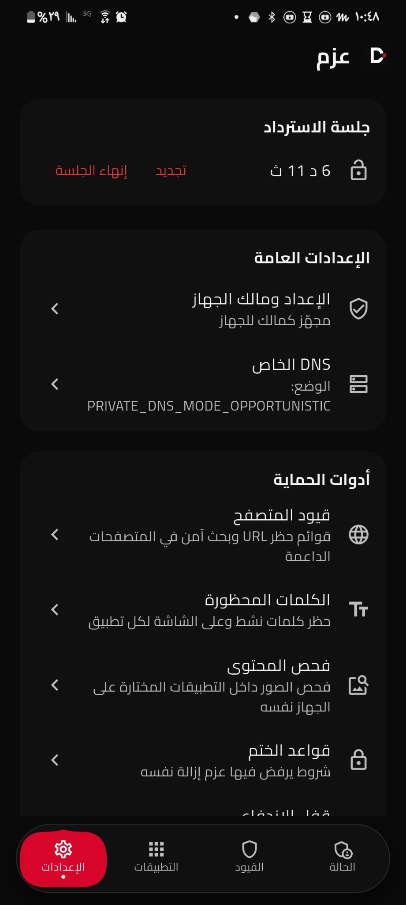

<p align="center">
  
</p>

<h1 align="center">Azm (عزم) — Self-Control & Digital Sovereign for Android</h1>

<p align="center">
  <a href="LICENSE"></a>
  <a href="https://flutter.dev"></a>
  <a href="#"></a>
  <a href="#"></a>
</p>

---

## Philosophy & Core Principles

**Azm (عزم)** is an uncompromising, on-device self-discipline and digital sovereignty companion for Android. Designed to conquer digital addiction and eliminate impulse relapse, Azm enforces absolute digital sovereignty through Android's native Device Owner management layer.

- **100% On-Device Execution:** Zero cloud servers, zero external backends, zero accounts, and zero telemetry. Your data, rules, and schedules never leave your hardware.
- **Uncompromising Self-Control:** Rules and restrictions are designed to be tamper-resistant. Once active, barriers cannot be impulsively dismissed or bypassed without dedicated cooling-off rituals or the physical paper recovery key.
- **Setup-Time Privilege Only:** [Shizuku](https://shizuku.rikka.app/) is utilized strictly as a one-time provisioning mechanism during initial setup to grant Device Owner privileges and permissions. Once provisioned, Azm operates fully autonomously and requires no background Shizuku daemon.
- **Privacy & Security First:** Recovery codes are never stored in plaintext. They are protected using a salted PBKDF2 cryptographic derivation.

---

## Screenshots

<p align="center">
  
  &nbsp; &nbsp;
  
</p>

---

## Features

### Strict Application Control
- **Deep Application Suspension & Hiding:** Suspend or hide distracting apps at the Android system level via DevicePolicyManager. Suspended applications cannot be opened or produce background distractions.
- **Uninstall Prevention:** Protect critical apps and Azm itself against impulsive uninstallation.
- **Usage Limits & Windows:** Configure daily usage limits per app or application group, and define allowed operating time windows.
- **Internal Activity Blocker:** Intercept and block specific distracting sub-activities inside applications.

### Network & Browser Hardening
- **Managed Browser Policies:** Push native enterprise browser restrictions to supported browsers (including Chrome and Chromium derivatives) to restrict URL patterns and enforce Google SafeSearch.
- **Forced Family Private DNS:** Lock in encrypted, privacy-respecting DNS providers with content-level protection directly at the operating system level.

### Accessibility Enforcement Engine
- **Tamper Reversion:** Continuous monitoring to safeguard essential accessibility services against unauthorized termination.
- **Proactive & Passive Content Guard:** Keyword filtering and on-device text scanning to keep apps aligned with your self-control goals.
- **Colour Modes:** Grayscale, night light, extra dim and colour inversion enforced at the system level on schedules, per app, and during focus sessions — with a recovery-gated lock against loosening and automatic release on removal, so the phone is never left grey with no way to switch it off.

### Self-Control Rituals & Gates
- **PBKDF2 Paper Recovery Key:** An unrecoverable 16-character recovery key designed to be written down on physical paper and stored securely. Modifying protected settings requires a deliberate physical friction ritual.
- **Scratch-to-Reveal Recovery Key:** At first launch the paper code stays hidden under a scratch cover until revealed, with a screen-reader alternative, and screenshots are blocked while it is shown.
- **Timed Recovery Sessions:** Emergency loosening sessions expire automatically after 10 minutes.
- **Focus & Discipline Challenges:** Mathematical drills and typing friction challenges ensure intentionality before sensitive restrictions can be altered.
- **Focus (Pomodoro) Sessions:** Deep-work cycles with strict enforcement and break timers.

---

## Architecture Overview

Azm adopts a clean two-tier architecture separating the user experience and state machine from privileged Android operating system interactions:

```
┌─────────────────────────────────────────────────────────┐
│                   Flutter / Dart UI                     │
│  · Material 3 (Red & Black visual identity)             │
│  · State management & client repositories               │
│  · Bilingual Arabic / English typography (Cairo font)   │
└────────────────────────────┬────────────────────────────┘
                             │
            MethodChannel: azm/privileged
            EventChannel:  azm/privileged/events
                             │
┌────────────────────────────▼────────────────────────────┐
│                  Native Kotlin Layer                    │
│  · AzmDeviceAdminReceiver & DeviceOwnerManager          │
│  · AzmAccessibilityService (runtime enforcement)        │
│  · ShizukuProvisioning (setup-time provisioning only)   │
│  · Keystore-backed cryptographic hash verification      │
└─────────────────────────────────────────────────────────┘
```

---

## Requirements & Setup

### Requirements
- Android 11+ (API Level 30 through 36)
- Shizuku app installed and running (required solely for the one-time initial setup provisioning)

### Initial Provisioning (Step-by-Step)
1. **Install Shizuku:** Download and launch Shizuku from its official source. Start the Shizuku service via Wireless Debugging or ADB as directed by Shizuku.
2. **Install & Launch Azm:** Open Azm. On first launch, the setup wizard guides you through provisioning.
3. **Grant Shizuku Access:** When prompted, grant Azm access to Shizuku.
4. **Provision Device Owner:** Tap **Provision Device Owner**. Azm will securely establish Device Owner administration.
5. **Grant Secure Settings & Accessibility:** Enable Azm's Accessibility Service and grant necessary secure settings.
6. **Set Paper Recovery Key:** Generate your 16-character recovery key, transcribe it onto paper, and keep it in a safe physical location.

> **Developer Notice:** Device Owner status grants extensive control over device policies. For development and testing, always use an emulator or a dedicated test device.

---

## Security & Privacy Architecture

- **Zero Network Communications:** Azm contains no analytics, advertising SDKs, error tracking services, or cloud connections. All data stays local to your device.
- **Irreversible Cryptographic Paper Key:** The paper recovery key is hashed using PBKDF2 with a cryptographic salt. Plaintext keys are never persisted to disk or flash memory.
- **Fail-Closed Operations:** If privileged components are compromised or unexpected state is detected, Azm defaults to maximum protection rather than failing open.

---

## Building from Source

### Prerequisites
- Flutter SDK 3.35.1+
- Android SDK (API 36, Build-Tools 35.0.0+)
- JDK 17+

### Build Commands
```bash
# Clone the repository
git clone https://github.com/alnajashia/azm.git
cd azm

# Fetch dependencies
flutter pub get

# Run test suite (149 tests)
flutter test

# Build release APK
flutter build apk --release
```

---

## License

This project is licensed under the Apache License 2.0. See the [LICENSE](LICENSE) file for details.
