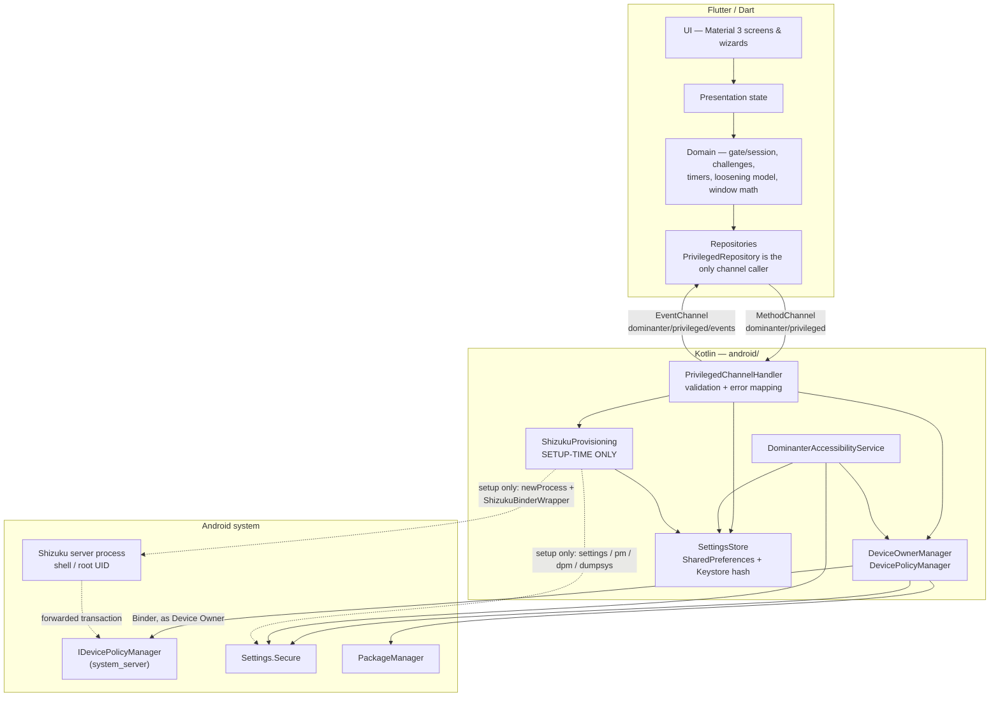

# Dominanter — Architecture

> **Project:** Flutter rebuild of DeChainer v1.12.0 (`io.github.warleysr.dechainer`, commit `29822c0`)
> **New applicationId:** `io.github.alnajashia.dominanter` (see §2)
> **Status:** Design — Stage 4/5 deliverable. No application code is implemented yet;
> see `IMPLEMENTATION_STATUS.md` for the honest status table.
> **Evidence base:** `analysis/DECHAINER_FEATURES.md` (features F1–F34, storage, DPM and
> Accessibility inventories), `analysis/SHIZUKU_INTEGRATION.md` (Shizuku integration),
> `analysis/REA_AND_GITHUB.md` (tooling / destination-repo context).
> Where this document and the original app disagree, the disagreement is a *documented
> deviation* (§7), never an accident.

---

## 1. Design principles

### 1.1 Flutter-first for everything Flutter is good at

All user interface, navigation, presentation state, and non-privileged application
logic live in **Dart / Flutter**:

- Material 3 UI (light + dark), navigation, forms, editors, dialogs, wizards.
- The recovery-gate / session model, challenge logic, impulse-lock and
  forced-removal timers, focus-session timer logic, loosening-vs-tightening
  computation, suspension-log presentation, and all settings editors.
- Validation that does not require a privileged Android API (e.g. "is this DNS
  hostname well-formed", "do these time windows overlap").

Dart code **never** claims a privileged effect happened. It only displays the
verified result returned from Kotlin (see §1.4).

### 1.2 ALL privileged effects live in Kotlin — no exceptions

Every operation that requires Device Owner, a system service, a protected
permission, or the Accessibility framework is implemented in **Kotlin** under
`android/`:

| Privileged domain | Kotlin owner |
|---|---|
| Device Owner provisioning and removal | `ShizukuProvisioning` (§3) |
| All `DevicePolicyManager` calls (hide / suspend / uninstall-block, user restrictions, application restrictions, private DNS, permission grant state) | `DeviceOwnerManager` |
| Accessibility Service (word / activity blocking, time limits & windows enforcement, install watcher, colour-filter tamper reversion, accessibility-loss lockdown) | `DominanterAccessibilityService` |
| `Settings.Secure` reads/writes for colour filters | `DeviceOwnerManager` / colour controller in Kotlin, using the `WRITE_SECURE_SETTINGS` grant obtained at setup |
| Shizuku binder, shell processes, binder-wrapped DPM reflection | `ShizukuProvisioning` only |
| Recovery-code hashing and verification | Kotlin (Keystore-backed store, §7.1) — Dart never sees or stores the code or its hash |
| Enforcement-critical persistent state | Kotlin `SettingsStore` (§8) |

There is no Dart package, plugin, or FFI path for any of the above. If a Flutter
plugin appears to offer one of these effects, it is not used for the effect —
at most it may be used for an unprivileged convenience (e.g. `local_auth` for
the F32 biometric prompt, whose *result* gates UI navigation only).

### 1.3 Shizuku is setup-time only — never in a runtime feature path

This is the single most important correction the reverse engineering produced,
and the architecture is built around it:

- In the original, Shizuku is a **bootstrap bridge**: it runs
  `dpm set-device-owner`, flips `user_setup_complete`, enables the
  Accessibility Service via `settings put`, grants `WRITE_SECURE_SETTINGS`,
  and runs setup diagnostics (`dumpsys account`, `pm list users`,
  `dpm list-owners`). After provisioning, **all** enforcement is
  `DevicePolicyManager` (as Device Owner) plus the Accessibility Service,
  with no Shizuku binder involved.
- Therefore, in this rebuild, Shizuku APIs may be imported **only** by the
  Kotlin provisioning layer (`ShizukuProvisioning`, §3). Runtime feature code
  — Dart and Kotlin alike — must not import, call, or depend on Shizuku.
  A code-review / lint rule enforces this: `rikka.shizuku.*` and
  `moe.shizuku.server.*` imports are allowed in the provisioning package only.
- Consequence, by design: if Shizuku is stopped, revoked, or uninstalled
  *after* setup, the app keeps enforcing everything. Shizuku state is a
  setup-screen concern, not an app-wide outage. The only post-setup operations
  that need Shizuku again are the ones the original needed it for:
  re-granting `WRITE_SECURE_SETTINGS`, toggling the Accessibility Service
  from inside the app, setup diagnostics, and the cold-start
  `user_setup_complete` repair — all of which live in the provisioning layer
  and fail with a clear, non-fatal error when Shizuku is unavailable.

### 1.4 Never fake success

- Every Kotlin privileged call verifies its result the way the strongest code
  in the original did: check the Boolean / result code, then **re-read the
  authoritative state** (`isDeviceOwnerApp`, `isApplicationHidden`,
  `isPackageSuspended`, `getGlobalPrivateDnsMode`, …) before reporting success.
- Shell commands are judged by **exit code** (and, where relevant, parsed
  stdout), never by "stderr was empty". This explicitly fixes the original
  `ShizukuRunner.command()` flaw (§5.4).
- Dart treats a channel error, a `null`/malformed reply, or a verification
  mismatch as **failure**, and renders it as failure. There are no placeholder
  buttons, simulated results, or optimistic success states for privileged
  operations.

### 1.5 Keep the original's safety model intact

The product is a self-imposed lockdown whose "adversary" is the user's future
impulsive self. The architecture preserves, as first-class Dart domain logic:

- Tightening a restriction is free; **loosening requires an active recovery
  session**, with the original's 5-second undo window for tightening changes
  (F23).
- A recovery session lasts **10 minutes**, is in-memory only, and ends when
  the session expires or the app process hosting it is destroyed (F23).
- Challenges gate the *opening* of a session (F22); the 48-hour forced
  removal is the only code-free escape from Device Owner (F2).
- Impulse-lock and forced-removal timers are resistant to wall-clock changes
  (dual RTC + `elapsedRealtime` accounting, as in the original).
- Accessibility loss fails **closed** (F28); every other enforcement check
  fails open, exactly as analysed in the original's error-handling inventory.

Deviations from the original are permitted only for security (§7) and are
listed there exhaustively.

### 1.6 Modularity without framework weight

- Dart: feature folders (`features/restrictions`, `features/apps`,
  `features/focus`, …), one repository per data domain (§8), plain
  state-management with no mandated heavy framework. The original used manual
  singletons and a string navigation stack; the rebuild uses idiomatic Flutter
  navigation and scoped state, but does not adopt an architecture framework
  whose only job would be ceremony.
- Kotlin: four bounded components (§3) with a single channel handler routing
  to them. No dependency-injection framework; constructors and a small
  application-scoped locator are sufficient at this size, mirroring the
  original's simplicity.
- The platform interface (§5) is the *only* coupling between Dart and Kotlin.
  Neither side reaches around it.

### 1.7 Testability follows the layer boundary

Dart domain logic (gate, timers, windows, loosening computation) is pure and
unit-testable without a device. Kotlin privileged components sit behind the
channel contract so Dart widget tests can run against a fake channel
implementation, and Kotlin components can be instrumentation-tested on a
device without Flutter in the loop (§9).

---

## 2. Package, platform, and dependency decisions

| Decision | Value | Justification |
|---|---|---|
| applicationId / namespace | `io.github.alnajashia.dominanter` | This is a **new app** by a different author. It cannot reuse `io.github.warleysr.dechainer`: Android treats applicationId as identity — reusing it would collide with the original install, its Device Owner record, and its Shizuku authorisation, and would misrepresent authorship. All strings derived from the id (Device Admin component, Accessibility component, Shizuku provider authority `${applicationId}.shizuku`, `dpm set-device-owner …` argument) are **generated from this id at build/runtime**, never copied verbatim from the original source. Display name: "Dominanter". |
| minSdk | **30** (Android 11) | Matches the original's envelope. Also the floor for `AccessibilityService.takeScreenshot` (API 30+) and the modern DPM surface the design relies on. No attempt is made to support API < 30. |
| targetSdk / compileSdk | **36 / 36** | Matches the original's envelope (`app/build.gradle.kts`: min 30, target 36, compile 36). Behaviour changes of the target SDK in force at build time must be re-checked before raising it. |
| Shizuku API | `dev.rikka.shizuku:api:13.1.5` | Exact Maven coordinates and version the original pins (`gradle/libs.versions.toml`: `shizuku = "13.1.5"`). Do not upgrade silently: the permission model, `IShizukuService` transactions, and pre-V11 semantics analysed in `SHIZUKU_INTEGRATION.md` are those of 13.1.5. |
| Shizuku Provider | `dev.rikka.shizuku:provider:13.1.5` | Same pin as the original. The manifest must declare `rikka.shizuku.ShizukuProvider` exactly as the API prescribes: authorities `${applicationId}.shizuku`, `exported=true`, `multiprocess=false`, permission `android.permission.INTERACT_ACROSS_USERS_FULL`. Without this provider no binder is ever delivered and `getShizukuState` can only report `notRunning`. |
| HiddenApiBypass | `org.lsposed.hiddenapibypass:hiddenapibypass:4.3` | Required for the DPM reflection path (§3.2): reflective access to `DevicePolicyManager.mService` and hidden `setDeviceOwner` / `setActiveAdmin` / `forceUpdateUserSetupComplete` overloads are blocked by hidden-API enforcement on API 28+. `HiddenApiBypass.addHiddenApiExemptions("")` is called from the Android `Application.onCreate` (SDK ≥ 28), as in the original. This dependency exists **only** for the provisioning layer. |
| LiteRT / TFLite | *Not in v1* | Only needed by the deferred NSFW pipeline (F16/F17, §6.2). Adding a 17 MB model and the LiteRT runtime to v1 for a deferred feature is not justified. Re-evaluate at the v1.1 spike. |
| Flutter–Kotlin bridge | `MethodChannel` + `EventChannel` (§5) | See §5.1 for the Pigeon note. |
| Biometric prompt (F32) | `local_auth` (UI gate only) | Equivalent to the original's `androidx.biometric` use. The fallback semantics (no biometric *and* no device credential enrolled ⇒ entry allowed, panic button reachable without auth) are a deliberate product decision carried over from the original and must be preserved consciously, with the state surfaced in the UI — not silently changed in either direction. |
| Local storage | Kotlin `SettingsStore` over `SharedPreferences` for enforcement-critical state; Dart repository layer on top (§8) | Mirrors the original (SharedPreferences only — no DataStore/Room in the original) and, critically, keeps enforcement state readable by the Accessibility Service when the Flutter engine is not running. |

**Licensing note:** DeChainer and Shizuku are both Apache License 2.0 (verified
in the analysis). Reuse of concepts, the Shizuku API library, and any adapted
code must carry the required attribution/NOTICE handling; Shizuku's README
additionally forbids reusing the name "Shizuku", its applicationId, its
launcher icons, or `moe.shizuku.manager.permission.*` for another app — this
project does none of those. A `LICENSE` file is added only after the
attribution set is finalised (see `IMPLEMENTATION_STATUS.md`).

---

## 3. Layer architecture

### 3.1 Diagram — ASCII

```text
┌─────────────────────────────────────────────────────────────────────────────┐
│ FLUTTER / DART                                                              │
│                                                                             │
│  UI (Material 3)                                                            │
│    Lock / biometric gate · Setup wizard · Restrictions · Apps · Groups      │
│    Config hub + sub-screens · Challenges · Recovery wizard/gate             │
│    Focus · Impulse lock · Suspension logs · Block activities (native-       │
│    hosted screens for TimeUp / BlockedWord / … are Kotlin Activities, §3.3) │
│         │                                                                   │
│  Presentation state (per-feature controllers / view models)                 │
│         │                                                                   │
│  Domain (pure Dart, unit-tested)                                            │
│    RecoveryGate + PendingChange loosening model · Session (10 min)          │
│    Challenges (math / words / reading) · Impulse & forced-removal timers    │
│    Focus cycle logic · Time-window / limit arithmetic · DNS validation      │
│         │                                                                   │
│  Repositories (Dart) — one per domain, §8                                   │
│    PrivilegedRepository (the ONLY caller of the platform channels)          │
│    SettingsRepository · SecurityRepository · UsageRepository · LogRepo      │
└──────────────────────────────┬──────────────────────────────────────────────┘
                               │  MethodChannel  "dominanter/privileged"  (§5)
                               │  EventChannel   "dominanter/privileged/events"
                               ▼
┌─────────────────────────────────────────────────────────────────────────────┐
│ KOTLIN — android/                                                           │
│                                                                             │
│  PrivilegedChannelHandler   (routing, arg validation, error mapping §5.4)   │
│         │                                                                   │
│  ┌──────────────────────┐  ┌──────────────────────┐  ┌───────────────────┐  │
│  │ ShizukuProvisioning  │  │ DeviceOwnerManager   │  │ SettingsStore     │  │
│  │  SETUP-TIME ONLY     │  │  RUNTIME             │  │  SharedPreferences│  │
│  │  · state / permission│  │  · DevicePolicyMgr   │  │  files (§8) +     │  │
│  │  · ShizukuRunner     │  │  · app hide/suspend/ │  │  Keystore-backed  │  │
│  │    (exit-code-checked│  │    uninstall-block   │  │  recovery hash    │  │
│  │    exec + command)   │  │  · user restrictions │  └───────────────────┘  │
│  │  · withShizukuDPM    │  │  · app restrictions  │                         │
│  │    reflection (§3.2) │  │    (browser policy)  │  ┌───────────────────┐  │
│  │  · setup bypass &    │  │  · private DNS       │  │ Dominanter-       │  │
│  │    stuck-flag repair │  │  · WRITE_SECURE_     │  │ Accessibility-    │  │
│  │  · diagnostics       │  │    SETTINGS grant*   │  │ Service           │  │
│  │  · accessibility     │  │  · colour Secure     │  │  RUNTIME          │  │
│  │    enable/disable*   │  │    settings writes   │  │  · limits/windows │  │
│  └──────────────────────┘  └──────────────────────┘  │  · words/activity │  │
│        * via Shizuku          * grant via Shizuku,   │  · install watch  │  │
│          (provisioning layer)   use is direct        │  · F28 lockdown   │  │
│                                                      └───────────────────┘  │
│  Also Kotlin: DominanterDeviceAdminReceiver · PolicyUpdateReceiver ·        │
│  FocusService (FGS) + boot/time/schedule receivers · block Activities ·     │
│  Android Application class (HiddenApiBypass, cold-start repair trigger,     │
│  orphaned colour-filter release, package-change cache invalidation)         │
└──────────────────────────────┬──────────────────────────────────────────────┘
                               │  Binder / ContentResolver / Settings
                               ▼
┌─────────────────────────────────────────────────────────────────────────────┐
│ ANDROID SYSTEM                                                              │
│  DevicePolicyManager ──Binder──▶ IDevicePolicyManager (system_server)       │
│  Settings.Secure (accessibility services, display/colour keys)              │
│  PackageManager (installed-app enumeration, MATCH_UNINSTALLED_PACKAGES)     │
│                                                                             │
│  SHIZUKU SERVER (separate process, moe.shizuku.privileged.api,             │
│  UID 2000 shell or UID 0 root) — reached ONLY by ShizukuProvisioning:       │
│    IShizukuService.newProcess()  ·  ShizukuBinderWrapper / transactRemote   │
└─────────────────────────────────────────────────────────────────────────────┘

  RUNTIME RULE: after provisioning, no arrow from any feature to the Shizuku
  server exists. Enforcement = DPM (Device Owner) + Accessibility Service.
```

### 3.2 Diagram — Mermaid



### 3.3 Component responsibilities

**Dart**

| Component | Responsibility |
|---|---|
| UI layer | All screens from the original's map (3 root tabs — Restrictions, Apps, Config — plus setup, lock gate, challenges, and config sub-screens), redesigned in Material 3. No privileged logic. |
| Domain | Recovery gate/session, `PendingChange` loosening computation, challenges, timers (impulse, forced removal, focus), time-window/limit arithmetic, suspension-log and usage presentation models. Pure Dart; no platform imports except through repositories. |
| Repositories | Translate domain calls into channel calls (§5) and native-store reads/writes; cache the app list; expose streams built on the EventChannel. `PrivilegedRepository` is the sole channel caller so the contract has exactly one Dart-side implementation to test. |

**Kotlin**

| Component | Responsibility |
|---|---|
| `PrivilegedChannelHandler` | Single `MethodChannel`/`EventChannel` handler. Validates arguments, dispatches to the components below on the correct thread (shell/DPM work off the main thread), maps every failure to the §5.4 error taxonomy. Contains no business logic of its own. |
| `ShizukuProvisioning` | **The only Shizuku consumer.** State detection, permission request/result, binder-received/dead listeners, `ShizukuRunner` (argv `exec` + compat `command`, both exit-code-checked, concurrent stream draining, timeout), `withShizukuDevicePolicyManager` reflection (§3.2 note below), `user_setup_complete` bypass/restore + cold-start stuck-flag repair, provisioning (binder path, then `dpm` shell fallback), diagnostics (`dumpsys account`, `pm list users`, `dpm list-owners`), Accessibility enable/disable via `settings put`, `WRITE_SECURE_SETTINGS` grant via `pm grant`. |
| `DeviceOwnerManager` | **Runtime DPM.** Owns the `ComponentName` for `DominanterDeviceAdminReceiver` and the `DevicePolicyManager` instance. Hide/suspend/uninstall-block, user restrictions, application restrictions (incl. browser policy push), private DNS, permission grant state for focus notifications, `clearDeviceOwnerApp`, and `Settings.Secure` colour-key writes using the already-granted permission. Contains **no Shizuku import**. |
| `DominanterAccessibilityService` | Runtime enforcement: usage session tracking (self-tracked, as in the original — *not* `UsageStatsManager`), limits/windows/reopen checks, active + passive word blocking, activity blocking, install watcher hooks, colour-filter sync/tamper reversion, impulse/focus suspension sync, and the F28 accessibility-loss lockdown. Reads enforcement state from `SettingsStore`; launches the Kotlin block Activities. Contains **no Shizuku import**. |
| `SettingsStore` | The only Kotlin reader/writer of the §8 SharedPreferences files, plus the Keystore-backed recovery-code hash (§7.1). Both the channel handler and the Accessibility Service go through it, replacing the original's pattern of 14 ad-hoc prefs handles in the service. |
| Native Activities / receivers / FGS | Block screens (`TimeUp`, `OutsideTimeWindow`, `ReopeningLimit`, `BlockedWord`, later `NsfwContentBlocked`), `AccessibilityRequestActivity`, focus reminder — all `singleInstance`, `excludeFromRecents`, `noHistory`, `showOnLockScreen` where the original did so. `DeviceAdminReceiver` (empty callbacks, as in the original — power comes from Device Owner status, not the legacy admin policies), policy-update receiver, `FocusService` (foreground service, `specialUse`), boot/time-change/schedule receivers. |

**Reflection-path note (carried from the analysis):** `withShizukuDevicePolicyManager`
reflectively swaps `DevicePolicyManager.mService` for a
`ShizukuBinderWrapper`-wrapped `IDevicePolicyManager` proxy, invokes the hidden
`setActiveAdmin` / `setDeviceOwner` / `forceUpdateUserSetupComplete` overloads
(found by signature probing, because they vary by Android version), and restores
the original service in a `finally`. It is inherently version-fragile, mutates a
shared framework object (restored, but not thread-safe — calls are serialised on
a single provisioning executor), and silently degrades to the `dpm` shell
fallback. It stays isolated inside `ShizukuProvisioning`, behind the channel,
with per-Android-version device tests (§9). It cannot be expressed in Dart and
must never leak into runtime code.

---

## 4. Communication rules between layers

Dart and Kotlin communicate only through the contract in §5. Three rules govern it:

1. **One caller:** `PrivilegedRepository` is the only Dart class that touches the
   channels; every feature goes through a domain repository that delegates to it.
2. **One handler:** `PrivilegedChannelHandler` is the only Kotlin class registered
   on the channels; it validates, dispatches to `ShizukuProvisioning` /
   `DeviceOwnerManager` / `SettingsStore`, and maps errors per §5.4.
3. **No side channels:** no intents, files, or shared globals are used to pass
   privileged requests or results around the contract. (Kotlin-internal
   communication — e.g. the Accessibility Service reading `SettingsStore` — is
   not a Dart↔Kotlin channel and is governed by §8.)

---

## 5. Platform-channel contract

### 5.1 Channels

| Channel | Type | Name |
|---|---|---|
| Privileged commands | `MethodChannel` | **`dominanter/privileged`** |
| Status / accessibility events | `EventChannel` | **`dominanter/privileged/events`** |

These names are fixed by this document. Dart code references them from one
constants file; Kotlin registers exactly these names in `MainActivity`'s
`configureFlutterEngine`. Note the spelling: the channel prefix is
`dominanter` (matching the applicationId's final segment), not `dominater`.

**Pigeon note (optional, deferred):** Pigeon would generate type-safe Dart/Kotlin
stubs for this contract and is a reasonable adoption **later**, once the contract
has survived first device testing without churn. It is *not* adopted for v1:
the contract below is small, several payloads are intentionally open maps
(application-restriction bundles, restriction metadata), and hand-written
handlers make the error mapping in §5.4 explicit. If Pigeon is adopted, this
section remains the normative contract and the generated API must match it
method-for-method; the channel names above are retained as the transport names
where Pigeon permits.

### 5.2 Conventions

- **Arguments** are `Map<String, Any?>` with the exact keys listed per method.
  Unknown keys are ignored; missing or wrongly-typed required keys fail with
  `INVALID_ARGUMENT` before any privileged work starts.
- **Returns** are `Map<String, Any?>` (never bare scalars) so fields can be
  added without breaking callers, except where a method is documented as
  returning a `List`. All maps below list their complete v1 keys.
- **Package names** are Android package-name strings. **Restriction keys** are
  `UserManager` key strings (e.g. `DISALLOW_CONFIG_VPN`). **Timestamps** are
  epoch milliseconds (`Int64`) unless stated as elapsed-realtime milliseconds.
- **Threading:** Kotlin executes shell, DPM-mutation, and package-enumeration
  methods on a background executor and replies asynchronously; Dart `await`s
  every call. No method blocks the platform thread.
- **Verification:** mutation methods return the *re-read* authoritative state,
  not merely "the call did not throw" (§1.4). If re-read disagrees with the
  request, the method fails with `DPM_FAILED` and `details.verifiedState`.
- **No method fakes a result when a precondition is missing.** Missing Device
  Owner, missing Shizuku, or a missing permission is an error (§5.4), not an
  empty success.

### 5.3 Methods

#### Shizuku state & permission — provisioning layer

##### `getShizukuState`
- **Args:** none.
- **Returns:** `{ state: String, serverVersion: Int?, serverUid: Int?, isPreV11: Boolean }`
  where `state` is exactly one of:
  | Value | Meaning (checked in this order) |
  |---|---|
  | `notInstalled` | `moe.shizuku.privileged.api` package not found. |
  | `notRunning` | Installed, but no live binder (`pingBinder() == false`). The app cannot start the server; UI directs the user to the Shizuku setup guide. |
  | `preV11` | Binder live but `Shizuku.isPreV11()` is true. Distinct state — the original collapsed this into "no permission"; the rebuild surfaces it so the user is told to update Shizuku. No privileged call is attempted in this state. |
  | `noPermission` | Binder live, current API, `checkSelfPermission() != PERMISSION_GRANTED`. |
  | `granted` | Binder live, current API, permission granted. |
- **Errors:** none expected — state reporting must not throw. Internal failures return `notRunning` with `details.diagnostic: String`.

##### `requestShizukuPermission`
- **Args:** none. (The request code is a Kotlin-side constant, `911`, as in the original; it is not a Dart parameter.)
- **Returns:** `{ requested: Boolean }` — `true` means the request was dispatched to the Shizuku server. The grant/deny **result** arrives asynchronously via the EventChannel (`shizukuPermissionResult`, §5.5) and via a subsequent `getShizukuState`. This method does not block waiting for the user.
- **Errors:** `SHIZUKU_NOT_RUNNING` (no binder), `SHIZUKU_PRE_V11`.
- **Rebuild fixes vs. original:** the result listener **verifies the request code** is `911` (the original ignored it) and the listener is registered/unregistered with the lifecycle (the original registered it in composition and never removed it). Liveness uses `addBinderReceivedListener` / `addBinderDeadListener` instead of the original's 500 ms polling loop.

#### Device Owner provisioning & removal — provisioning layer + DPM

##### `provisionDeviceOwner`
- **Args:** none.
- **Returns:** `{ isDeviceOwner: Boolean, pathUsed: String, commandOutput: String }`
  where `pathUsed` is `binderDpm`, `shellFallback`, or `alreadyOwner`, and
  `commandOutput` is the accumulated human-readable output of the shell fallback
  (empty for the binder path) for display in the setup dialog, as in the original.
- **Behaviour (fixed sequence):** read `user_setup_complete`; if `1`, set it to
  `0` and refresh via the wrapped DPM; attempt binder-wrapped
  `setActiveAdmin` + `setDeviceOwner`; if not owner afterwards, fall back to
  `dpm set-device-owner <applicationId>/.DominanterDeviceAdminReceiver`;
  **in a `finally`, restore `user_setup_complete` to `1` and refresh**; re-check
  `isDeviceOwnerApp`; on success, also attempt the `WRITE_SECURE_SETTINGS` grant
  (failure of the grant does not un-provision the owner — it is reported in
  `commandOutput` and can be retried via `grantWriteSecureSettings`).
- **Errors:** `SHIZUKU_NOT_RUNNING`, `SHIZUKU_NO_PERMISSION`, `SHIZUKU_PRE_V11`,
  `SHELL_FAILED` (with `details.exitCode`, §5.4), `PROVISIONING_FAILED`
  (both paths attempted, still not owner; `details` carries each path's outcome),
  `TIMEOUT`.

##### `removeDeviceOwner`
- **Args:** none. (Authorisation — active recovery session or completed 48-hour
  forced removal — is enforced in **Dart before this call is made**, and Kotlin
  additionally requires `isDeviceOwnerApp == true`. There is deliberately no
  channel argument that could bypass the Dart gate from a compromised UI state;
  the session model itself is §6/F23.)
- **Returns:** `{ isDeviceOwner: Boolean }` — re-read after `clearDeviceOwnerApp`; success requires it to be `false`.
- **Errors:** `DPM_NOT_OWNER`, `DPM_FAILED`. No Shizuku is used (as in the original).

##### `isDeviceOwner`
- **Args:** none.
- **Returns:** `{ isDeviceOwner: Boolean, isAdminActive: Boolean }`.
- **Errors:** none expected.

##### `getProvisioningDiagnostics`
- **Args:** none.
- **Returns:** `{ accounts: List<{type: String, name: String}>, extraUsers: List<{id: Int, name: String}>, currentOwner: {packageName: String, receiver: String}? }`
  from the original's three diagnostic commands (`dumpsys account`,
  `pm list users`, `dpm list-owners`), parsed Kotlin-side. Purely informational
  setup warnings; an empty/absent result never blocks provisioning by itself.
- **Errors:** `SHIZUKU_NOT_RUNNING`, `SHIZUKU_NO_PERMISSION`, `SHELL_FAILED` (per-command detail in `details.commandResults`).

#### App management — Device Owner (runtime, no Shizuku)

##### `listInstalledApps`
- **Args:** `{ includeSystem: Boolean }`.
- **Returns:** `List<{ packageName: String, label: String, isSystem: Boolean, isHidden: Boolean, isSuspended: Boolean, isUninstallBlocked: Boolean, hasExplicitContentRating: Boolean? }>`
  enumerated via `PackageManager` with `MATCH_UNINSTALLED_PACKAGES`, DPM state
  re-read per package (a failed per-package DPM probe degrades that flag to
  `false`, mirroring the original's defensive idiom, and is counted in the
  EventChannel diagnostics — it does not fail the whole list).
  `hasExplicitContentRating` is the cached F20 value where present in v1.1+;
  in v1 it is always `null` (see F20 scope decision, §6.2).
- **Errors:** `DPM_NOT_OWNER` is **not** raised for enumeration itself (listing
  works without owner; the DPM flags are then all `false`). `INTERNAL` only.

##### `setAppHidden`
- **Args:** `{ packageName: String, hidden: Boolean }`.
- **Returns:** `{ packageName: String, isHidden: Boolean }` — re-read via `isApplicationHidden`.
- **Notes:** includes the original's Android 14+ workaround (on a failed
  `false → true` transition, reset to `false` first, then re-apply). The local
  hidden-packages set in `SettingsStore` is persisted **only on verified success**.
- **Errors:** `DPM_NOT_OWNER`, `PACKAGE_NOT_FOUND`, `DPM_FAILED`.

##### `setAppSuspended`
- **Args:** `{ packageNames: List<String>, suspended: Boolean, reason: String? }`
  where `reason`, when present, is a `SuspensionReason` name (`MANUAL`,
  `UNSUPPORTED_BROWSER`, `TORRENT_APP`, `RATED_18_PLUS`, `VISUAL_BLOCKING`,
  `IMPULSE_LOCK`, `FOCUS_MODE`, `ACCESSIBILITY_DISABLED`) and causes a
  suspension-log entry to be written Kotlin-side at the moment of the effect —
  so suspensions performed by the Accessibility Service and by the UI are
  logged identically (F27).
- **Returns:** `{ results: List<{ packageName: String, isSuspended: Boolean }> }` — per-package re-read state; a package whose re-read disagrees is reported with its actual state and the call fails with `DPM_FAILED` listing it in `details.failedPackages` (partial success is never reported as full success).
- **Errors:** `DPM_NOT_OWNER`, `PACKAGE_NOT_FOUND`, `DPM_FAILED`, `INVALID_ARGUMENT` (empty list).

##### `setUninstallBlocked`
- **Args:** `{ packageName: String, blocked: Boolean }`.
- **Returns:** `{ packageName: String, isUninstallBlocked: Boolean }` — re-read.
- **Errors:** `DPM_NOT_OWNER`, `PACKAGE_NOT_FOUND`, `DPM_FAILED`.

#### User restrictions — Device Owner (runtime)

##### `listUserRestrictions`
- **Args:** none.
- **Returns:** `{ restrictions: List<{ key: String, active: Boolean, recommended: Boolean }> }`
  covering every `UserManager` `DISALLOW_*` / `ALLOW_*` / `ENSURE_*` key
  discoverable by the original's reflection approach (plus the OEM/Knox extras
  the original included), with `active` from `getUserRestrictions` and
  `recommended` marking the original's pre-selected set — authoritatively the
  **four** keys in code: `DISALLOW_CONFIG_VPN`, `DISALLOW_CONFIG_PRIVATE_DNS`,
  `DISALLOW_FACTORY_RESET`, `DISALLOW_INSTALL_UNKNOWN_SOURCES_GLOBALLY`
  (the original README says three; the code is authoritative).
- **Errors:** `DPM_NOT_OWNER`.

##### `applyUserRestriction`
- **Args:** `{ key: String }`.
- **Returns:** `{ key: String, active: Boolean }` — re-read; success requires `active == true`.
- **Errors:** `DPM_NOT_OWNER`, `INVALID_ARGUMENT` (unknown key), `DPM_FAILED`.

##### `clearUserRestriction`
- **Args:** `{ key: String }`.
- **Returns:** `{ key: String, active: Boolean }` — re-read; success requires `active == false`.
- **Errors:** as `applyUserRestriction`. (Loosening authorisation is the Dart gate's job, F23, before this call.)

#### Application restrictions — Device Owner (runtime)

##### `getApplicationRestrictions`
- **Args:** `{ packageName: String }`.
- **Returns:** `{ packageName: String, restrictions: Map<String, Any?> }` — the current managed-restrictions bundle converted to a plain map (String/Boolean/Int/String-list values), plus, where the target app declares them, restriction metadata is returned by `listInstalledApps`-adjacent discovery in the per-app editor flow (manifest restriction entries: key, type, title, entries). Bundle↔map conversion lives in Kotlin; Dart never sees an Android `Bundle`.
- **Errors:** `DPM_NOT_OWNER`, `PACKAGE_NOT_FOUND`.

##### `setApplicationRestrictions`
- **Args:** `{ packageName: String, restrictions: Map<String, Any?>, merge: Boolean }`
  (`merge = true` preserves existing keys not present in the map, as in the
  original's editor; `merge = false` replaces the bundle).
- **Returns:** `{ packageName: String, restrictions: Map<String, Any?> }` — re-read via `getApplicationRestrictions`; mismatch ⇒ `DPM_FAILED`.
- **Errors:** `DPM_NOT_OWNER`, `PACKAGE_NOT_FOUND`, `INVALID_ARGUMENT` (unsupported value type), `DPM_FAILED`.
- **Browser policy (F5) is this method, specialised in Dart:** the Dart
  browser-restrictions feature computes, for each supporting browser (one whose
  manifest restrictions declare **both** `URLBlocklist` and
  `ForceGoogleSafeSearch`), the bundle
  `{ URLBlocklist: List<String>, ForceGoogleSafeSearch: Boolean }` from the
  user's named blocklists and calls `setApplicationRestrictions` per browser.
  Browser support detection is exposed as:

##### `listRestrictionCapableApps`
- **Args:** `{ requiredKeys: List<String> }` (for browsers: `["URLBlocklist", "ForceGoogleSafeSearch"]`; empty list returns every app that declares any managed restrictions, backing the F4 editor; torrent-handler detection for F19 passes its intent criteria in v1.1 via the same method's `intentActions` extension point — not in the v1 contract).
- **Returns:** `List<{ packageName: String, label: String, declaredKeys: List<String> }>`.
- **Errors:** `PACKAGE_NOT_FOUND` is never raised for the list form; `INTERNAL` only.

#### Private DNS — Device Owner (runtime)

##### `setPrivateDns`
- **Args:** `{ hostname: String }` — a validated specified-host name (presets: Cloudflare Family, AdGuard Family, CleanBrowsing, or a custom host validated in Dart and re-validated in Kotlin).
- **Returns:** `{ mode: String, hostname: String? }` — re-read via `getGlobalPrivateDnsMode` / `getGlobalPrivateDnsHost`. The original's DPM result-code mapping and 15-second timeout discipline are preserved Kotlin-side; a timeout is `TIMEOUT`, not success.
- **Errors:** `DPM_NOT_OWNER`, `INVALID_ARGUMENT`, `DPM_FAILED`, `TIMEOUT`.

##### `getPrivateDns`
- **Args:** none.
- **Returns:** `{ mode: String, hostname: String? }` (`mode` is the DPM private-DNS mode name, e.g. `PRIVATE_DNS_MODE_PROVIDER_HOSTNAME_SPECIFIED`).
- **Errors:** `DPM_NOT_OWNER`.

#### Secure-settings grant & Accessibility — provisioning layer

##### `grantWriteSecureSettings`
- **Args:** none.
- **Returns:** `{ granted: Boolean }` — re-checked with the permission check after running `pm grant <applicationId> android.permission.WRITE_SECURE_SETTINGS` via Shizuku. Success requires `granted == true`.
- **Errors:** `SHIZUKU_NOT_RUNNING`, `SHIZUKU_NO_PERMISSION`, `SHIZUKU_PRE_V11`, `SHELL_FAILED` (with exit code).

##### `setAccessibilityEnabled`
- **Args:** `{ enabled: Boolean }`.
- **Returns:** `{ isEnabled: Boolean }` — re-read from `Settings.Secure` (`enabled_accessibility_services` + `accessibility_enabled`) after the `settings put` commands. Enabling appends this app's Accessibility component to the existing colon-separated list (preserving other services); disabling removes it (writing `'null'` only if the list becomes empty, as in the original). Before an intentional disable, Kotlin sets the `SettingsStore` intentional-disable flag that suppresses the F28 lockdown — the equivalent of the original's `prepareServiceDisable()` / `disablingService` guard.
- **Errors:** `SHIZUKU_NOT_RUNNING`, `SHIZUKU_NO_PERMISSION`, `SHELL_FAILED` (with exit code), `DPM_FAILED` (re-read mismatch).

##### `isAccessibilityEnabled`
- **Args:** none.
- **Returns:** `{ isEnabled: Boolean, isServiceRunning: Boolean }` — `isEnabled` from `Settings.Secure`; `isServiceRunning` from the service's own live state. The two can disagree (enabled but not yet bound) and the UI must show that honestly.
- **Errors:** none expected. (This read does **not** require Shizuku; only the *toggle* does.)

#### Usage — Accessibility-owned data, read via channel

##### `getUsageToday`
- **Args:** `{ packageName: String? }` — `null` returns all packages/groups.
- **Returns:** `{ date: String, packages: List<{ packageName: String, usedMs: Int64 }>, groups: List<{ groupId: String, usedMs: Int64 }> }`
  read from `SettingsStore` (`internal_usage_stats` / `group_usage_stats`).
  Usage is **self-tracked by the Accessibility Service** (foreground-session
  accumulation on `elapsedRealtime`, reset on date change), exactly as in the
  original. It is **not** `UsageStatsManager` data, and the rebuild does not
  request `PACKAGE_USAGE_STATS` without a new, documented reason (the original
  declared it but never used it).
- **Errors:** none expected.

#### Recovery-code verification — Kotlin only (§7.1)

##### `setRecoveryCode`
- **Args:** `{ code: String }` — the newly generated/confirmed code, passed once, over the channel, for hashing. Dart retains no copy after this call returns.
- **Returns:** `{ isSet: Boolean }`.
- **Errors:** `INVALID_ARGUMENT` (format), `INTERNAL`.

##### `verifyRecoveryCode`
- **Args:** `{ code: String }`.
- **Returns:** `{ matches: Boolean }` — constant-time comparison against the stored salted hash in Kotlin. There is intentionally **no method that returns the stored code or hash to Dart**.
- **Errors:** `INVALID_ARGUMENT`, `INTERNAL`.

##### `isRecoveryCodeSet`
- **Args:** none. **Returns:** `{ isSet: Boolean }`. **Errors:** none expected.

### 5.4 Error taxonomy — exit codes are mandatory

Every `PlatformException` from `dominanter/privileged` carries:

```text
code:    one of the codes below (String, stable, machine-readable)
message: human-readable summary (not localised Kotlin-side; Dart maps code → UI copy)
details: Map with, where applicable:
           exitCode: Int?        // shell process exit code — see below
           command: String?      // the argv/command template that failed (no secrets)
           stdout: String?       // trimmed, length-capped
           stderr: String?       // trimmed, length-capped
           verifiedState: Any?   // re-read state when verification failed
           cause: String?        // exception class + message for INTERNAL/DPM_FAILED
```

| Code | Meaning |
|---|---|
| `INVALID_ARGUMENT` | Missing/wrongly-typed arg, unknown restriction key, unsupported bundle value, malformed hostname/code. No privileged work was attempted. |
| `SHIZUKU_NOT_INSTALLED` | Shizuku package absent (used by provisioning-attempt methods; `getShizukuState` reports this as a state instead). |
| `SHIZUKU_NOT_RUNNING` | No live Shizuku binder. |
| `SHIZUKU_NO_PERMISSION` | Binder live, permission denied. |
| `SHIZUKU_PRE_V11` | Pre-v11 Shizuku server; fail closed, no privileged call attempted. |
| `SHIZUKU_BINDER_DEAD` | Binder died mid-operation. The operation's outcome is **unknown** and must be re-verified by the caller — it is never reported as success. |
| `SHELL_FAILED` | A Shizuku shell process exited non-zero or could not be started. `details.exitCode` is **always** present when a process ran. |
| `PROVISIONING_FAILED` | Both provisioning paths attempted; device is still not Device Owner. |
| `DPM_NOT_OWNER` | A Device Owner-only method was called without Device Owner status. |
| `DPM_FAILED` | A DPM call threw, returned failure, or its re-read verification disagreed. |
| `PACKAGE_NOT_FOUND` | Target package is not installed. |
| `PERMISSION_DENIED` | A required Android permission (other than Shizuku's) is not held. |
| `UNSUPPORTED_ANDROID` | The device's API level / hidden-API surface does not support the operation (e.g. a reflective overload absent on this build). |
| `TIMEOUT` | The operation exceeded its bound (shell commands and DNS apply have explicit timeouts; the original had none for shell — the bound is a rebuild improvement, documented here). |
| `INTERNAL` | Anything else. `details.cause` is mandatory. |

**The `command()` flaw, fixed explicitly:** the original
`ShizukuRunner.command()` never checked the process exit code — a command that
failed with a non-zero exit and empty stderr was reported to its listener as
`done = true` (success). That behaviour is **not** ported. In this rebuild:

1. Both runner flavours (`exec` argv form and the `sh -c` compat form) drain
   stdout and stderr **concurrently** (the original `command()` drained them
   sequentially, a pipe-deadlock risk the `exec` form already avoided with a
   thread), wait for the process, and return `(exitCode, stdout, stderr)`.
2. Every caller checks `exitCode == 0` before treating output as valid, and
   every channel method that ran a shell command surfaces a non-zero exit as
   `SHELL_FAILED` with `details.exitCode` set.
3. "Empty stderr" is never, anywhere, a success criterion.

### 5.5 EventChannel — `dominanter/privileged/events`

A single event stream; each event is a `Map` with a `type` key. Dart's
`PrivilegedRepository` demultiplexes it into typed streams. Events are
advisory UI signals — Dart re-reads authoritative state (`getShizukuState`,
`isDeviceOwner`, `isAccessibilityEnabled`) on receipt rather than trusting
the event payload as state.

| `type` | Payload | Source / meaning |
|---|---|---|
| `shizukuBinderReceived` | `{}` | `addBinderReceivedListener` fired. Replaces the original's 500 ms polling. |
| `shizukuBinderDead` | `{}` | `addBinderDeadListener` fired; any in-flight provisioning call fails with `SHIZUKU_BINDER_DEAD`. |
| `shizukuPermissionResult` | `{ requestCode: Int, granted: Boolean }` | Result of `requestShizukuPermission`. Dart ignores results whose `requestCode != 911`. |
| `deviceOwnerChanged` | `{ isDeviceOwner: Boolean }` | Owner status changed (provisioning, removal, or policy-engine callback). |
| `accessibilityStateChanged` | `{ isEnabled: Boolean, isServiceRunning: Boolean }` | Service connected/unbound or the Secure setting changed. An unbind **without** the intentional-disable flag also triggers the F28 lockdown Kotlin-side; this event is how the UI learns it happened. |
| `accessibilityStatus` | `{ controlledPackagesSuspended: Boolean }` | Follow-up to an F28 lockdown / restore, so the UI can show exactly what was suspended or restored. |
| `packageChanged` | `{ packageName: String, change: String }` (`added`/`removed`/`replaced`) | Invalidates the Dart app-list cache, as `DechainerApplication` did in the original. |
| `focusPhaseChanged` | `{ phase: String }` | Focus session phase transitions driven by the Kotlin FGS/alarms while the UI is alive. |
| `suspensionLogged` | `{ packageName: String, reason: String }` | A new F27 log entry was written (by the UI path or by the Accessibility Service), so an open log screen can refresh. |

---

## 6. Feature mapping — F1–F34

Scope vocabulary:

- **Core v1** — in the first shippable rebuild. Absence would make v1 not
  functionally equivalent in a way a user would immediately hit.
- **v1.1 later** — designed for (§5 extension points noted), deliberately not
  in v1, with the reason stated. Not a euphemism for "dropped".
- **Not ported** — will not be built in its original form, with the reason and
  the closest legitimate alternative stated.

### 6.1 The table

| # | Feature (short name) | Dart component | Kotlin component | Scope |
|---|---|---|---|---|
| F1 | Device Owner provisioning via Shizuku (+ `user_setup_complete` bypass) | Setup wizard UI; `PrivilegedRepository.provisionDeviceOwner` | `ShizukuProvisioning` (runner + `withShizukuDevicePolicyManager` reflection + `dpm` fallback) | **Core v1** |
| F2 | Device Owner removal (immediate in session; 48-h forced removal) | Forced-removal timer/state in domain; Config dialogs | `DeviceOwnerManager.clearDeviceOwnerApp` via `removeDeviceOwner` | **Core v1** |
| F3 | System restrictions (all `UserManager` keys, draft/apply) | Restrictions tab, draft model, loosening computation | `DeviceOwnerManager` via `apply/clear/listUserRestrictions` | **Core v1** |
| F4 | Per-app managed-restrictions editor | AppRestrictions screen + editor widgets | `DeviceOwnerManager` via `get/setApplicationRestrictions`, `listRestrictionCapableApps` | **Core v1** |
| F5 | Browser restrictions (`URLBlocklist` + `ForceGoogleSafeSearch`) | BrowserRestrictions screen; blocklist CRUD; per-browser bundle computation | `DeviceOwnerManager` via `setApplicationRestrictions`, `listRestrictionCapableApps` | **Core v1** |
| F6 | Non-supporting-browser auto-suspension on install/first open | Settings toggle + status (v1.1) | Accessibility install watcher + `DeviceOwnerManager.setPackagesSuspended` | **v1.1 later** — §6.2 |
| F7 | Forced family private DNS | Config DNS dialog (presets + custom) | `DeviceOwnerManager` via `set/getPrivateDns` | **Core v1** |
| F8 | Per-app hide / suspend / uninstall-block | Apps tab + management dialogs | `DeviceOwnerManager` via `setAppHidden/Suspended/UninstallBlocked`, `listInstalledApps` | **Core v1** |
| F9 | Per-app/group daily & per-weekday time limits; lock at expiry | Time-limit editors; usage presentation | Accessibility Service tracking/enforcement + block Activities; `getUsageToday` | **Core v1** |
| F10 | Allowed time windows (daily / per-weekday); block outside | Time-windows editors; window arithmetic in domain | Accessibility Service enforcement | **Core v1** |
| F11 | Reopening cooldown | Editor field in app management | Accessibility Service + home-screen detection | **v1.1 later** — home/launcher detection is OEM-fragile (the original depends on seeing the launcher before a "close" counts; popups/recents/notifications cancel it). The limit/window core (F9/F10) ships first; cooldown joins it once launcher detection is validated across launchers on device. |
| F12 | Staged usage warnings | UsageWarning screen; stage editor | Accessibility remaining-time computation + Kotlin notifier/receiver | **Core v1** |
| F13 | App groups (shared limits/windows) | Groups dialogs; group editors | Accessibility enforcement via `SettingsStore` group data; DPM suspension for group actions | **Core v1** |
| F14 | Active word blocking | BlockedWords screen (words + target apps) | Accessibility Service focused-field check + `BlockedWordActivity` | **Core v1** |
| F15 | Passive word blocking (per-app on-screen words) | BlockedWords screen (per-app lists) | Accessibility Service screen-text scan | **Core v1** |
| F16 | Visual (NSFW) TFLite blocking | VisualBlocking screen (v1.1) | Accessibility screenshot + node-tree media heuristics + LiteRT detector (v1.1) | **v1.1 later** — §6.2 |
| F17 | Visual-blocking escalation (N in M min ⇒ suspend D min) | Escalation fields on VisualBlocking screen (v1.1) | Suspension tracker + Accessibility restore/timers (v1.1) | **v1.1 later** — depends entirely on F16; no purpose shipping its tracker alone. |
| F18 | Activity blocker + seen-activities log | ActivityBlocker screen | Accessibility Service class-name matching + accessed-activities log | **v1.1 later** — power-user feature; its Accessibility plumbing shares the F14/F15 event path, but the live activity log, its retention, and the block-list UX are separable and not on the v1 critical path. |
| F19 | Torrent-app auto-blocking | Toggle in Config (v1.1) | PackageManager intent resolution + Accessibility install watcher + DPM suspend | **v1.1 later** — ships with the F6/F20 install-watcher family (§6.2); the manual controls it depends on (F5/F8) are Core v1. |
| F20 | 18+ auto-suspension via Play Store scraping | — (badge shown only if data exists) | — | **Not ported (scraping form)** — §6.2 |
| F21 | Impulse lock (15 min–6 h, optional app suspension, pre-auth panic button) | ImpulseLock screen; timer in domain; panic button on lock gate | `DeviceOwnerManager` suspension sync from Accessibility Service | **Core v1** |
| F22 | Access challenges (Math / Words / Tetris / Reading) | Challenge screens + runner — **pure Dart**: Math, Words, Reading in v1; **Tetris in v1.1** | None (success calls Dart `SecurityManager.startSession` equivalent) | **Core v1 (Math/Words/Reading); Tetris v1.1 later** — §6.2 |
| F23 | Recovery gate + 10-min session; tightening free (5 s undo), loosening gated | `RecoveryGate`, `PendingChange`, session state — domain, faithfully reimplemented | None (gate guards channel calls; removal additionally relies on session per `removeDeviceOwner`) | **Core v1** |
| F24 | Recovery-code wizard (generate 16-char, paper, re-type to confirm) | Wizard screens; shuffled-keypad option | `setRecoveryCode` hashing (§7.1) | **Core v1** |
| F25 | Focus mode (Pomodoro; suspend apps/groups + restrictions; schedules; FGS countdown) | FocusMode screen; **cycle/timer logic in Dart domain**; session card (incl. pre-auth card) | `FocusService` (FGS) + alarms/receivers; `DeviceOwnerManager` suspension/restriction claim-release; DPM grant-state juggling for its own notification permission | **Core v1** |
| F26 | Colour modes on schedule (grayscale/night/extra-dim/inversion, tamper-proof) | ColorFilter screen (v1.1) | Secure-settings controller + Accessibility `ContentObserver` reversion + overlay fallback (v1.1); **the `grantWriteSecureSettings` channel method itself is Core v1** (provisioning already needs it) | **v1.1 later** — enforcement writes ~7 `Settings.Secure` keys, must save/restore user originals exactly, reverts Quick-Settings tampering via observers, and needs an OEM-specific fallback (e.g. Samsung night-display absence). High OEM variance; not on the lockdown critical path. |
| F27 | Suspension audit log | SuspensionLogs screen (search + clear) — **portable Dart** over `SettingsStore` data | Log writing at the point of every suspension (`setAppSuspended` reason + Accessibility suspensions) | **Core v1** |
| F28 | Accessibility-loss lockdown | Status surfacing via EventChannel; re-enable plea screen is a Kotlin Activity | Accessibility Service `onUnbind` lockdown + `onServiceConnected` restore | **Core v1** — the anti-bypass keystone: a port without it is not equivalent. Implemented with the original's exact controlled-package definition and intentional-disable guard, and tested first on a sacrificial device (§9). |
| F29 | Silent APK update installer (incl. downgrade, lock-screen, unauthenticated) | — | — | **Not ported (unauthenticated form)** — §6.2, §7.2 |
| F30 | Setup wizard (Shizuku-state-driven onboarding) | Setup screens + state machine (notInstalled → notRunning → preV11 → noPermission → granted → owner) | All provisioning-layer methods | **Core v1** |
| F31 | First-run recovery-setup gate (app unusable until a code exists) | Startup routing in Dart | `isRecoveryCodeSet` | **Core v1** |
| F32 | Biometric / device-credential entry gate | Lock gate UI via `local_auth`; panic/focus surfaces remain pre-auth by design | None | **Core v1** |
| F33 | Language selection (en / pt) | Config language dialog; Flutter localisation (en/pt from v1) | None | **Core v1** |
| F34 | Debug-only self-disable hatch | — | — | **Not ported** — §7.3 |

### 6.2 Explicit scope calls (justifications)

**F16/F17 — NSFW TFLite pipeline: v1.1 later, as a dedicated spike.**
This is the largest and riskiest single component in the original: a
1,546-line Accessibility Service path that takes screenshots
(`takeScreenshot`, API 30+), walks the node tree with language- and
app-specific media-region heuristics (including Reddit-specific patterns and a
geometric fallback), crops regions, and classifies them with a 17 MB
MobileNetV2 TFLite model on a thread-affine LiteRT interpreter, then
force-closes apps via suspend/un-suspend, with a persisted sliding-window
escalation tracker (F17). No Flutter plugin provides any part of this pipeline.
Its failure modes — false positives suspending a user's apps, battery/thermal
cost of a 2-second scan cadence, screenshot permission variance across OEMs,
model licensing/redistribution terms for the bundled weights — each need
device evidence, not optimism. v1 therefore ships the complete lockdown
*without* visual classification, the Visual Blocking screen is absent (not a
disabled placeholder), and F16/F17 enter v1.1 only after a standalone Kotlin
spike proves detection quality and cost on a real device. F17 has no
independent existence and follows F16.

**F22 Tetris challenge: v1.1 later; Math / Words / Reading are Core v1.**
The challenges are portable Dart — that is precisely why three of the four
ship in v1: Math (5 problems), Words (type the required sequence correctly),
and Reflective Reading (timed word-by-word reveal from the bundled
Bible/Quran/quotes/custom corpora) are bounded UI+logic with no platform risk,
and together they preserve the gate's friction model. Tetris is a different
kind of work: a complete game engine (gravity curves, levels, lock delay,
line-clear animation, synthesised sound effects cached as WAVs) whose
*security* contribution is only "configurable 1–15 minutes of delay". Building
a faithful Tetris before the lockdown core is verified would invert the
project's priorities. It is a self-contained v1.1 module behind the same
`ChallengeType` selection UI; in v1 the Tetris option is absent from the
challenge multi-select (not shown disabled), and existing challenge
combinations work without it.

**F20 — Play Store rating scraping: not ported in its original form.**
The original fetches each newly installed / first-opened app's Play Store web
page with Jsoup and suspends the app iff the page's rating text is *exactly*
the English string `"Rated 18+"` *and* an explicit-content flag is present.
That is HTML scraping of a third-party site: brittle by construction
(page-format changes silently break it), locale-dependent (the exact-match
string fails in other locales/languages), and with no official API behind it.
Rebuilding v1 on top of it would bake a known-fragile external dependency into
a safety feature and invite false confidence in both directions (missed 18+
apps, and suspensions justified by a misparsed page). Decision: the scraping
implementation is **not ported**. v1 ships without automatic 18+ suspension
and says so in its UI/docs; the `hasExplicitContentRating` field in
`listInstalledApps` is reserved (`null` in v1) so a future mechanism —
investigated as a v1.1 research spike (e.g. any supported content-rating
signal, or a curated/user-confirmed list) — can fill it without a contract
change. Manual suspension (F8), browser policy (F5), and torrent/browser
auto-suspension (F6/F19, v1.1) are unaffected.

**F29 — Silent APK updater: not ported in its original (unauthenticated) form.**
See §7.2, which is both the scope call and the security deviation.

**Portable-Dart confirmations:** the following are Dart domain/UI with no
native effect of their own, and are scheduled as such — challenges (F22,
above), the recovery gate/session model including `PendingChange` loosening
computation (F23) and the wizard flow (F24), the suspension log's storage
model and UI (F27; its *producers* are Kotlin), and focus timer/cycle logic
(F25; its suspension, restriction, alarm, and FGS effects are Kotlin).

---

## 7. Security deviations from the original — explicit and justified

Anything not listed here is intended to match the original's behaviour,
including where the original is aggressive (F28) or permissive (F32 fallback).

### 7.1 (a) Recovery code: salted hash, never plaintext

- **Original:** `SecurityManager.saveRecoveryCode()` writes the raw 16-character
  code as a plaintext string into `recovery_prefs` SharedPreferences, and
  validation is a plain string comparison. Anyone/anything that can read that
  file (root, backup extraction, a future sandbox escape) recovers the single
  key to the entire lockdown.
- **Rebuild:** the code is hashed Kotlin-side with a per-install random salt
  using a deliberately slow KDF — **PBKDF2WithHmacSHA256** (high iteration
  count, tuned on device) — and only `(salt, hash, iterations)` are stored, in
  a dedicated `recovery_secure` store whose file is additionally protected
  where the platform allows (Android Keystore-backed encryption of the store
  entry, e.g. via Jetpack Security / `EncryptedSharedPreferences` equivalent
  maintained for the project's SDK envelope). Verification
  (`verifyRecoveryCode`, §5.3) recomputes and compares in constant time.
  Dart never persists the code, the salt, or the hash.
- **Justification:** the code is a low-entropy human-transcribed secret
  (16 chars, A–Z in the original) guarding every loosening operation. Plaintext
  at rest is an unjustifiable risk with a standard, cheap fix. The user-visible
  behaviour (generate → write on paper → re-type to confirm → enter to open a
  session) is unchanged.
- **Consequence, stated honestly:** the stored code can no longer be
  *displayed* again after setup (the original could read it back). The wizard
  must say this plainly: lose the paper copy and the only remaining paths are
  the challenges/session model as designed and the 48-hour forced removal (F2).
  Migration from an original install is not offered in v1 (different
  applicationId, §2, makes it a fresh install anyway).

### 7.2 (b) No unauthenticated lock-screen APK install surface in v1

- **Original (F29):** a silent update/downgrade installer for already-installed
  apps, reachable **from the lock screen without authentication**, using
  `PackageInstaller` sessions, temporary lifting of the unknown-sources
  restrictions, and uninstall-and-restore-state for downgrades. Its mitigation
  is the already-installed-only constraint.
- **Rebuild:** v1 has **no** lock-screen install surface at all, silent or
  otherwise, and no downgrade path. This is a scope removal (§6.2) *and* a
  security deviation.
- **Justification:** an unauthenticated surface that can replace the code of an
  installed app is a privilege-boundary crossing whose exploit value does not
  depend on the user's self-control threat model — a *different* person holding
  the locked phone is outside that model, yet gains an app-replacement vector.
  The feature exists only to work around the app's own unknown-sources
  restriction (F3); v1 accepts the resulting inconvenience (updates happen by
  temporarily loosening that restriction inside an authenticated recovery
  session, then re-tightening) rather than shipping the workaround's attack
  surface.
- **Closest legitimate alternative (v1.1 candidate, not promised):** an
  *authenticated, in-session* update flow — user picks an APK inside a recovery
  session, the app verifies package identity and signature continuity, installs
  via a user-visible `PackageInstaller` confirmation, no downgrades, no
  lock-screen entry. It requires its own security review before scheduling.

### 7.3 (c) No debug self-disable hatch in release — and none that ships by accident

- **Original (F34):** in `BuildConfig.DEBUG` builds, an exported receiver for a
  custom action sets the intentional-disable flag, auto-starts a recovery
  session, lifts the unknown-sources restriction, stops the focus service, and
  disables the Accessibility Service.
- **Rebuild:** this hatch is **not ported in any build that leaves the
  developer's machine**. Release builds contain no such receiver, no
  auto-session path, and no restriction-lifting shortcut.
- **Justification:** a self-disable hatch is a bypass of the product's entire
  safety model; its safety rests solely on a build-type flag and an exported
  component's obscurity. Developer convenience during testing is served by
  standard means instead: on a developer/test device, disable the service via
  Android Settings or `adb`, or uninstall the (test) Device Owner build —
  sacrificial test devices are already the project's testing posture (§9).
  If local debug builds ever reintroduce a hatch for developer ergonomics, it
  must be behind a build-config flag that is *absent* (not merely `false`) in
  the release source set, and its existence must be recorded in
  `IMPLEMENTATION_STATUS.md`. v1 plans no such hatch at all.

### 7.4 Hardening carried alongside (not behaviour changes)

These fix implementation flaws found in the analysis without changing any
user-visible behaviour, and are recorded here so they are not mistaken for
scope changes:

1. **Shell exit codes are always checked** (§5.4) — fixing
   `ShizukuRunner.command()`'s never-check-the-exit-code flaw; concurrent
   stdout/stderr draining; shell timeouts.
2. **Shizuku permission-result listener verifies request code `911`** and is
   unregistered with the lifecycle (the original did neither).
3. **Binder liveness via listeners**, not 500 ms polling (§5.3).
4. **Pre-V11 Shizuku is a distinct UI state**, not silently "no permission" (§5.3).
5. **Corrupt-prefs handling:** the original's "decode failure ⇒ empty/default"
   idiom can silently *loosen* restrictions. The rebuild keeps fail-safe
   decoding for UI state, but enforcement-critical decoders in `SettingsStore`
   log the corruption and the Accessibility Service treats unreadable
   enforcement state as "keep the last verified state / fail closed for
   suspensions already in force", never as "no restrictions configured".

---

## 8. Data model

### 8.1 Principles

1. **Fidelity where sensible:** store names and key names mirror the original's
   SharedPreferences schema (analysis §6) so behaviour, debugging, and any
   future migration tooling line up with the analysed system. Where the rebuild
   deviates (recovery code, §7.1), the store name changes too, so the deviation
   is visible in the data layout itself.
2. **Two runtimes, one schema:** the Accessibility Service and the FGS run when
   the Flutter engine may not. Enforcement-critical state therefore lives in
   Kotlin-owned SharedPreferences (via `SettingsStore`) and Dart accesses it
   through repositories over the channel — Dart is never the *only* holder of
   state the service needs. Pure-UI state (navigation, drafts before Apply,
   editor scratch) lives Dart-side only.
3. **Single writer per store:** each store below names its writer. The service
   is a *reader* of configuration stores and the *writer* of measurement/log
   stores; the UI (via Kotlin) is the writer of configuration stores. The
   original communicated between layers by the service listening to
   SharedPreferences changes; the rebuild keeps that mechanism Kotlin-side
   (`SettingsStore` change listeners registered by the service), so a Dart-side
   write that lands in the native store re-triggers enforcement exactly as in
   the original.
4. **In-memory by design:** the recovery-session deadline is memory-only
   (Dart domain state), as in the original — process death ends the session.
   The app-list cache and the seen-activities log are likewise memory-only in
   v1 (the original kept `accessedActivities` in a companion object).

### 8.2 Stores

Kotlin `SettingsStore` files (names = original file names unless marked ◆):

| Store (file) | Writer | Reader(s) | Contents (keys mirror the original) |
|---|---|---|---|
| `security_prefs` | Dart via channel / Kotlin | Dart, service | `shuffle_keyboard`, `block_torrents`, `access_challenges`, `tetris_minutes` (v1.1), `tetris_sound`, `reading_source`, `reading_count`, `reading_custom_passages` (JSON), `impulse_action`, `impulse_duration_minutes`, `impulse_suspended_apps`, `impulse_active_suspension`, impulse-block start RTC + elapsed + duration + active flag. ◆ F29 staging keys are **absent** (feature not ported). Debug keys are **absent** (§7.3). |
| ◆ `recovery_secure` (replaces `recovery_prefs` for the code) | Kotlin only | Kotlin only | `recovery_code_salt`, `recovery_code_hash`, `recovery_code_kdf_iterations` (§7.1). The plaintext `recovery_code` key **does not exist**. |
| `recovery_prefs` | Dart domain via channel | Dart, Kotlin | Non-secret recovery state only: `forced_removal_active`, `forced_removal_accumulated`, `forced_removal_last_elapsed`. |
| `app_limits` / `app_weekly_limits` | Dart via channel | Service, Dart | Per-package daily minutes (Int) / per-weekday CSV of 7 Ints. A package lives in at most one of the two, as in the original. |
| `app_time_windows` / `app_weekly_time_windows` | Dart via channel | Service, Dart | Per-package JSON `[{s,e},…]` minutes-of-day / JSON array of 7 day-arrays. |
| `internal_usage_stats` | Accessibility Service | Dart via `getUsageToday`, service | Per-package accumulated usage ms (self-tracked; cleared on date change by the service). |
| `group_usage_stats` | Accessibility Service | Dart, service | Per-group-id accumulated usage ms. |
| `reopen_times` | Dart via channel | Service | Per-package reopening-cooldown seconds (v1.1 enforcement; stored from v1 if the editor ships dark — otherwise added in v1.1). |
| `app_groups` | Dart via channel | Service, Dart | Groups as JSON: id, name, members, limit, windows. |
| `hidden_apps_prefs` | Kotlin (`DeviceOwnerManager`) | Kotlin, Dart | `hidden_packages` StringSet — survives uninstall/reinstall so hidden state is re-applied, as in the original. Written only on verified DPM success. |
| `blocked_words_prefs` | Dart via channel | Service | `blocked_words` (StringSet), `target_packages` (StringSet), `passive_words_<pkg>` (StringSet per app). |
| `visual_blocking_prefs` ◆ v1.1 | Dart via channel | Service | `enabled`, `target_packages`, `categories`, `threshold`, `suspend_enabled`, `suspend_block_count`, `suspend_window_minutes`, `suspend_duration_minutes`. Not created in v1. |
| `visual_blocking_suspensions` ◆ v1.1 | Service | Service | Sliding-window block timestamps + active suspension deadlines per package. Not created in v1. |
| `usage_warning_prefs` | Dart via channel | Service, Dart | `enabled`, `stages` (JSON: id, minutes, type, vibrationCount). Defaults mirror the original (15 min silent, 5 min sound, 1 min vibrate×1, 0.5 min vibrate×3). |
| `color_filter_prefs` ◆ enforcement v1.1 | Dart via channel | Service, colour controller | `enabled`, `modes`, per-mode `windows_<MODE>` / `scope_<MODE>` / `excluded_apps_<MODE>` / `only_apps_<MODE>`, `night_light_overlay_intensity`, `night_light_temperature`, `extra_dim_level`. |
| `color_filter_state` ◆ v1.1 | Kotlin colour controller | Kotlin | `saved_keys` + `previous_<secure-key>` — the user's original display settings, for exact restoration; plus orphan-release state used at app start. |
| `focus_prefs` | Dart via channel + Kotlin focus components | Dart, `FocusService`, service | Durations/cycles/flags, `suspended_apps`, `suspended_groups`, `focus_restrictions`, live phase (`phase`, `phase_start_rtc`, `phase_start_elapsed`, `phase_duration`, `phase_boot_count`, `paused_remaining`, `pause_releases`, `completed_focus`, `active_suspension`, `active_restrictions`). |
| `focus_schedules_prefs` | Dart via channel | Kotlin schedule receivers | Serialised focus-schedule list. |
| `browser_prefs` | Dart via channel | Dart, (F5 push reads it Dart-side) | `blocked_lists_json` — array of `{id, title, sites}`. |
| `app_ratings` ◆ v1.1, mechanism TBD | Service (v1.1) | Dart, service | Per-package explicit-content cache. **Not created in v1** (F20 not ported, §6.2); the file name is reserved so a v1.1 mechanism reuses the schema, not the scraper. |
| `activity_blocker_prefs` ◆ v1.1 | Dart via channel | Service | `blocked_activities` (StringSet of class names). |
| `suspension_logs_prefs` | Kotlin (at every suspension site) | Dart | JSON array of log entries: timestamp, package, `SuspensionReason`, detail. Capped/pruned Kotlin-side so the file cannot grow unboundedly (the original had no cap; a cap is a robustness fix, recorded here). |

Dart-side repositories (one per domain, all delegating privileged/persistent
access to `PrivilegedRepository` + channel-mediated `SettingsStore` access):

`SecurityRepository` (challenges config, impulse config, recovery state —
never the code itself), `RestrictionsRepository`, `AppsRepository` (list cache
+ per-app settings), `GroupsRepository`, `BrowserRestrictionsRepository`,
`WordsRepository`, `FocusRepository`, `UsageRepository`, `SuspensionLogRepository`,
`SetupRepository` (Shizuku/owner state machine). Non-persistent UI state
(navigation stack, restriction *drafts* before Apply, wizard progress) is held
in presentation state only, mirroring the original's draft/apply model for F3.

### 8.3 Dart ↔ Kotlin state flow (worked example)

Applying a time limit (F9): Dart editor → `AppsRepository` → channel-mediated
`SettingsStore` write to `app_limits` → Kotlin prefs-change listener in the
Accessibility Service re-reads tracking config → enforcement changes without an
app restart and without Shizuku. The channel call returns only after the native
write commits, so Dart never shows "saved" for a write the service cannot see.

---

## 9. Testing strategy

The master prompt's 17 test areas, mapped to test levels. **"Real device"**
means a physical Android device (a sacrificial one — Device Owner provisioning
and F28 can lock a device out of casual use); "Emulator" is acceptable only
where marked. A feature is never reported as verified on the basis of a build
succeeding (§1.4); `IMPLEMENTATION_STATUS.md` carries the per-feature verdict.

| # | Test area | Level(s) | Real device required? | Notes |
|---|---|---|---|---|
| 1 | First launch | Widget + instrumentation + manual | Yes (final pass) | Fresh install → F31 gate (no recovery code ⇒ wizard only). Emulator OK for the routing logic. |
| 2 | Application initialisation | Unit (Dart) + instrumentation | No | `Application.onCreate` duties: HiddenApiBypass, orphaned colour-filter release (v1.1), focus sync, package-receiver registration, cold-start repair trigger (no-ops safely without binder — the original's unit-tested contract). |
| 3 | Shizuku installation detection | Instrumentation + manual | **Yes** | Requires the real Shizuku manager app present/absent. Emulator without Shizuku only covers `notInstalled`. |
| 4 | Shizuku service status detection | Instrumentation + manual | **Yes** | Server started via ADB (and via wireless debugging) vs. stopped; binder-received/dead listeners, not polling. |
| 5 | Permission request | Manual + instrumentation | **Yes** | `requestPermission(911)` dialog in the Shizuku manager; request code verified in the result listener. |
| 6 | Permission authorization (grant) | Manual | **Yes** | Grant ⇒ state machine advances to the owner step; grant persists across app restart. |
| 7 | Permission denial | Manual | **Yes** | Deny ⇒ distinct `noPermission` state, no privileged call attempted, no fake progress. Revocation in the Shizuku manager after setup ⇒ runtime features keep working, provisioning-layer features fail cleanly (the §1.3 consequence, tested explicitly). |
| 8 | Shizuku connection (binder lifecycle) | Instrumentation + manual | **Yes** | Binder death mid-operation ⇒ `SHIZUKU_BINDER_DEAD`, outcome re-verified, never success. Server restart after reboot (non-rooted: server must be re-started by the user) ⇒ setup UI recovers via listeners. |
| 9 | Binder communication (wrapped DPM) | Instrumentation (Kotlin) | **Yes** | The §3.2 reflection path per Android version in the envelope (API 30–36 spread, incl. an Android 14+ device for the hidden-state workaround interplay). Forced failure of the binder path ⇒ shell fallback engages; `user_setup_complete` is `1` after both paths and after a simulated crash mid-provisioning (cold-start repair). |
| 10 | Every implemented system operation | Instrumentation + manual checklist | **Yes** | Per channel method (§5.3): hide/suspend/uninstall-block, each recommended restriction + a sample of others, application restrictions incl. a real supporting browser (F5), private DNS against each preset + custom, accessibility toggle, `WRITE_SECURE_SETTINGS` grant. Each verified by re-reading system state *outside* the app (Settings / `adb shell dpm`, `settings get`) — not only via the app's own getters. |
| 11 | Service disconnection | Manual | **Yes** | Stop the Shizuku server post-setup ⇒ all Core runtime features still enforce (DPM + Accessibility); provisioning-layer actions report `SHIZUKU_NOT_RUNNING`. Accessibility service stop ⇒ F28 behaviour (area 12/§9 note). |
| 12 | Authorization revocation | Manual | **Yes** | Shizuku revocation (area 7) and Device Owner removal paths: in-session removal, and forced removal started/cancelled/completed at 48 h (clock/elapsed accounting tested with accelerated state, then a real short-cycle run on the sacrificial device). |
| 13 | Unsupported Android versions | Unit + emulator | No (emulator) | API < 30 ⇒ install blocked by minSdk (verified, not assumed). Pre-V11 Shizuku ⇒ distinct `preV11` state, fail closed. Hidden-API variance ⇒ `UNSUPPORTED_ANDROID` surfaces instead of a crash (reflection probes). |
| 14 | Application lifecycle changes | Widget + instrumentation + manual | Partially | Process death ends the recovery session (F23); rotation/backgrounding during provisioning does not strand `user_setup_complete = 0` (repair path); reboot ⇒ focus phases/alarms resync (boot receiver), impulse/forced-removal elapsed accounting survives, NSFW suspensions n/a in v1. |
| 15 | Error handling | Unit (Dart + Kotlin) + fault injection | Partially | Every §5.4 code is produced by at least one test: non-zero shell exit (the §5.4 regression test — a failing command with empty stderr must **not** report success), dead binder, not-owner calls, corrupt prefs (enforcement state must not silently loosen, §7.4.5), DNS timeout. |
| 16 | UI responsiveness | Widget + profile-mode manual | Partially | No privileged call on the platform thread; app-list load over a large installed set; passive word scan must not jank the service (tested on device in v1 profiling). |
| 17 | Data persistence | Unit + instrumentation | No (emulator OK) | Every §8.2 store round-trips; restart persistence for limits/windows/groups/words/focus/schedules/logs; hidden-packages set survives target-app reinstall; session state does **not** persist (by design). |

**Standing rules**

- Dart unit tests cover the pure domain first — the original's own unit tests
  are the specification reference (`PendingChange`/loosening, `RecoveryGate`,
  focus cycles/schedules, time windows, system-restrictions set): equivalent
  cases are ported as Dart tests before the corresponding UI is built.
- Kotlin instrumentation tests target the channel contract (§5) directly, so a
  failure localises to Dart, contract, or Kotlin without ambiguity.
- F28 (accessibility-loss lockdown) and provisioning are tested **first on a
  sacrificial device** with a known recovery path, never first on a daily-use
  phone — the original's lockdown suspends every controlled package and blocks
  installs, and a buggy port can strand a device.
- REA's future role is at the APK stage only (per `REA_AND_GITHUB.md`):
  `identify-flutter-build` / `inspect-dart-aot` / signature inspection on our
  own built APK. REA plays no part in Kotlin/Dart correctness testing.

---

## 10. Risks and open spikes (in priority order)

1. **Provisioning reflection spike (before any feature work):** prove
   `withShizukuDevicePolicyManager` + HiddenApiBypass + the 13.1.5 provider on
   a real device across the API 30–36 envelope; prove the `dpm` fallback and
   the stuck-flag repair. Everything else is behind Device Owner.
2. **Accessibility Service on Flutter:** the service, its block Activities, and
   the FGS must coexist with the Flutter Activity/engine lifecycle (service
   keeps enforcing with the engine dead; block Activities are native). Prove
   with F9 + F14 before building their editors.
3. **F28 safety:** controlled-package definition and the intentional-disable
   guard need a dedicated test harness and a documented device-recovery
   procedure before the feature is enabled in any shared build.
4. **OEM variance:** restriction-key reflection, launcher detection (v1.1 F11),
   and Secure-settings keys differ by OEM (the original already carries Knox
   extras and a Samsung night-light fallback). Budget device time, not just
   emulator time.
5. **Shizuku server restart after reboot** (non-rooted devices) is a user
   step the app cannot perform; the setup/repair UX must explain it without
   implying the app is broken — and, per §1.3, it only matters for
   provisioning-layer repairs, not for daily enforcement.

---

*End of architecture. Implementation progress against this design is tracked in
`IMPLEMENTATION_STATUS.md`.*
